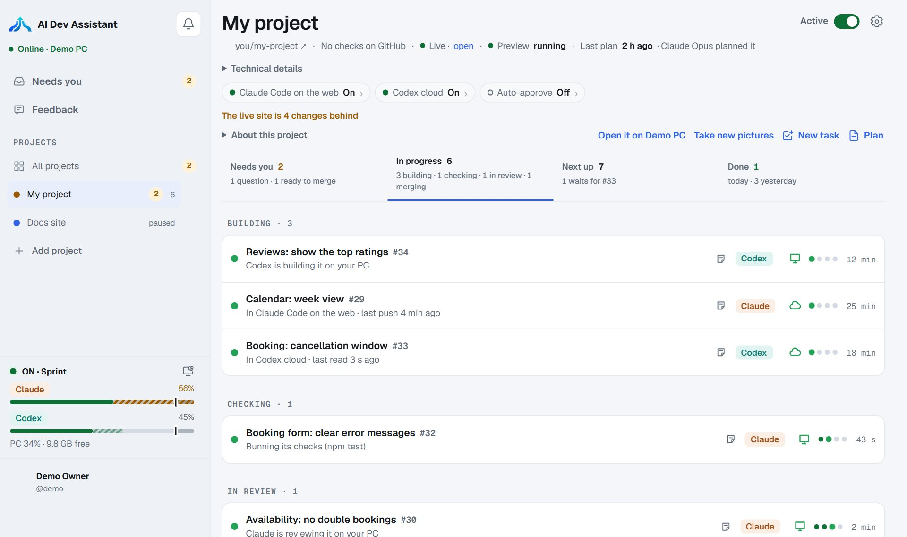
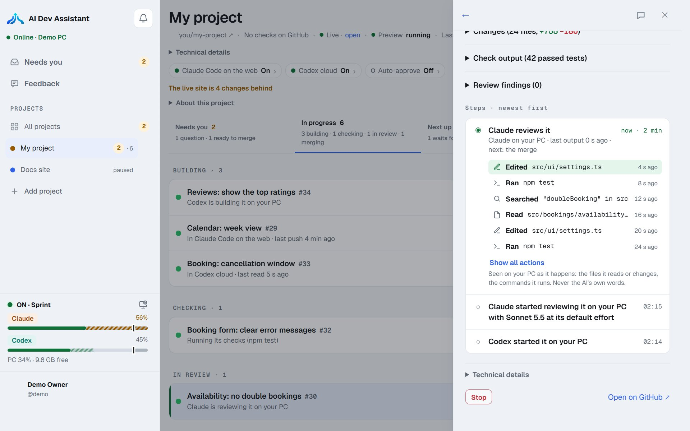

# AI Dev Assistant

**From roadmap to reviewed code.**

AI Dev Assistant develops your projects, with or without GitHub, around the clock while your PC is on, with the AI subscriptions you already have: **Claude** and **Codex**. A program called the assistant runs on your own computer: checks and merges run there, and a task finished in a cloud waits for it.

It turns your project's plan into tasks. Claude or Codex builds each one on your computer or in its cloud, your project's own checks run when it has them, the other AI reviews it when both can work, and only that reviewed commit reaches main. You manage, approve and answer from its dashboard on your PC, with no account. The online dashboard is closed to new people for now.

It is for a person who wants a project to move forward every day, while keeping each change checked and reviewed.

You get before and after pictures of the changed pages it can open.

This repository holds AI Dev Assistant's install guide, [release notes](CHANGELOG.md), security policy and issue forms. The program's source is private; the installers and every update come from [ai-dev-assistant.agile-clouds.com](https://ai-dev-assistant.agile-clouds.com).





## What you need

- A Claude or ChatGPT plan, the one you already pay for. One is enough. You can use both.
- A computer: 64-bit Windows 10 (version 1803 or later) or 11, macOS 13 or later, or 64-bit Linux. Mac and Linux need Git.
- A GitHub account only for projects kept on GitHub. A project can also live in a folder on your PC without GitHub.

Optional paid use is off by default: you can set an extra weekly budget, or use your own Anthropic key for Claude, with a dollar cap.

## Install

No account and no administrator rights are needed for the first install. Mac and Linux need Git first.

**Windows, in PowerShell**

```powershell
irm https://ai-dev-assistant.agile-clouds.com/install.ps1 | iex
```

**Mac or Linux**

```sh
curl -fsSL https://ai-dev-assistant.agile-clouds.com/install.sh | sh
```

Setup opens in your browser. Choose Claude, Codex or both, sign in, then add a project. Nothing starts with your computer: you start it.

You can read the install scripts before you run them: [Windows](https://ai-dev-assistant.agile-clouds.com/install.ps1) or [Mac and Linux](https://ai-dev-assistant.agile-clouds.com/install.sh).

## Your first project

1. **Add a project.** In your dashboard, press **Add project**: a folder on your PC, or a GitHub repository. You review the checks and settings it finds before any task runs.
2. **Plan it.** A **planning meeting** asks you questions, then drafts the goal and its milestones. Nothing starts until you approve the plan.
3. **Choose how much you decide.** **You decide**, the default, asks you to approve each task and each merge. **Autopilot** lets the AIs plan, build and merge, and still asks what only you can decide.
4. **Turn development ON.** One AI builds each task, your project's checks run, the other AI reviews it, and the reviewed commit reaches main. **Needs you** gathers every question and approval.
5. **See the result.** Each task shows its changes, its checks and its review. **Open it on your PC** runs the current version, and pictures show the pages a task changed.
6. **Publish when you want.** The plan's **Publish** card puts an accepted milestone live on GitHub Pages, Netlify, Vercel, Railway or your own command.

## What stays on your PC

A new install keeps its dashboard and its data on your PC, with no account. Your tasks, proof, rules and publish history stay there. Your AI and GitHub sign-in tokens stay on your PC and are never sent to the website.

A PC that was online before can still use Move online. When you move the dashboard online, your PC locks project details with your account's key before they leave it. Read [Privacy and terms](https://ai-dev-assistant.agile-clouds.com/privacy) for what the dashboard receives and keeps, and the terms that apply.

## Updates and the release key

Your PC checks the public version file when its dashboard opens and once a day. When a newer version is ready, **Update now** shows what changes. Your PC checks the signature, size and checksum before it installs the update. A failed update changes nothing.

Release key fingerprint: `e6f8-ac27-4363-57ca`

The install checks the assistant's release with this key before unpacking it; your PC checks every update against it before downloading. The install line itself is not signed: the first install trusts the dashboard that serves it.

## Stop or uninstall

To stop it, open **Your PC** and press **Stop the assistant**. On Windows, you can also use **Stop the assistant** from its icon by the clock. Closing the browser does not stop it. Each task keeps its saved work and continues from there when you start again.

To remove it, stop it first, then use:

- Windows: **Uninstall AI Dev Assistant** in the Start menu.
- Mac: `~/Library/Application\ Support/AI\ Dev\ Assistant/uninstall`
- Linux: `~/.local/share/ai-dev-assistant/uninstall`

Uninstall keeps your projects folder, sign-ins, Claude Code and GitHub work. A PC first set up on this computer keeps a checked local backup of the assistant's projects, tasks and choices so that **Welcome back** can offer them after another install. A PC moved online keeps the same backup on this computer, then is taken offline, and its online copy is removed. A PC linked without a screen is taken offline too; its dashboard keeps a backup when one can be made.

## Feedback and security

Already using AI Dev Assistant? Open **Feedback** in your dashboard. For a question before you start, use [Contact us](https://ai-dev-assistant.agile-clouds.com/#contact) or email [contact@agile-clouds.com](mailto:contact@agile-clouds.com).

For a security problem, follow [SECURITY.md](SECURITY.md). Do not put keys, tokens, passwords or `.env` contents in an issue.

## Licence

AI Dev Assistant is free to download and use under its [licence](LICENSE), and the online dashboard has no charge during the beta. Your AI plan, and any paid use you switch on, are billed by their providers.
